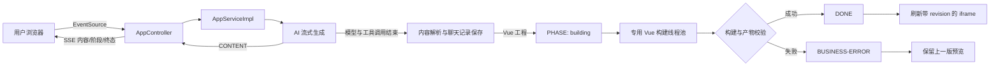

# hu-ai-code-mother 项目优化复盘与技术沉淀总结

> - 项目：hu-ai-code-mother（单体应用）
> - 优化范围：AI 流式生成、Vue 项目构建、SSE 状态协议、预览刷新及前端流式渲染
> - 优化日期：2026-09-14
> - 适用模块：根目录 Spring Boot 单体应用、`hu-ai-code-mother-frontend`
> - 不在范围：`hu-ai-code-mother-microservice` 业务实现

---

## 1. 项目背景与痛点分析

### 1.1 背景

平台通过大模型流式生成 HTML、多文件项目或 Vue 工程，并在生成完成后提供在线预览。Vue 工程与普通 HTML 不同：大模型完成代码生成后，还需要执行依赖安装和 Vite 构建，产出 `dist/index.html` 后才具备可预览条件。

本次优化由以下用户体验问题触发：

1. 多个用户同时生成网站时，后续请求看起来像被串行阻塞，首段可见内容等待时间较长；
2. Vue 模式中，AI 回复结束与预览可用之间存在状态断层，可能短暂显示旧页面；
3. 构建失败仍可能被前端按成功处理，无法区分“代码已生成”和“预览已构建”；
4. 长 Vue 回复流式输出时，Chrome 出现“页面无响应”，页面交互被明显阻塞。

### 1.2 根因拆解

#### 1.2.1 AI 请求并非全局串行，但共享并发资源有限

单体应用中的流式模型使用固定大小为 6 的共享线程池。两路真实请求测试显示，上游请求可以并发启动，因此不存在全局单请求锁；但并发超过 6 路后仍会进入排队。

同时，模型服务在本次测试中的首个可见内容延迟约为 45～51 秒。当前 OpenAI 兼容适配层只转发 `delta.content()`，不展示服务商特有的推理字段，因此“上游已开始处理”与“用户看到首段正文”之间可能存在较长时间差。

#### 1.2.2 Vue 构建占用 AI 流线程

优化前，Vue 构建由 LangChain4j 的完成回调同步触发。`npm install` 和 `npm run build` 会继续占用共享 AI 流线程，延迟流结束并降低其他用户可获得的 AI 并发槽位。

#### 1.2.3 SSE 完成语义不完整

优化前缺少明确的“正在构建”阶段，且构建结果与最终 `done` 没有形成严格约束。前端只能依据连接状态猜测是否成功，存在以下风险：

- 构建失败后仍刷新预览；
- 浏览器自动重连导致有副作用的 GET 请求被重复执行；
- 用户无法判断当前看到的是旧预览还是新版本；
- 构建期间长时间无消息，连接可能被中间网络设备关闭。

#### 1.2.4 前端流式渲染形成近似平方级开销

优化前，每个 SSE 内容分片都会执行以下链路：

```text
收到分片
  → 拼接完整响应前缀
  → 写入响应式 message.content
  → markdown-it 重新解析完整内容
  → highlight.js 重新高亮所有已完成代码块
  → v-html 替换完整渲染子树
  → 读取 scrollHeight 并启动平滑滚动
```

随着回复长度增长，第 N 次更新处理的是从第 1 个分片到第 N 个分片的全部内容，总工作量近似为：

```text
1 + 2 + 3 + ... + N = O(N²)
```

Vue 工程回复通常包含大量 Vue、TypeScript、CSS 和 Markdown 代码围栏，因此该问题远比普通短文本明显。截图中的卡顿发生在“正在生成代码”阶段，而不是后续“正在构建预览”阶段；运行时采样也未发现活跃的 Vue 构建线程，最终确认浏览器主线程渲染是此次“页面无响应”的直接原因。

---

## 2. 优化目标与设计原则

### 2.1 优化目标

- AI 内容保持实时可见，不因性能优化退化为等待完整结果后一次性显示；
- Vue 构建不继续占用共享 AI 流线程；
- 只有新构建产物真实可用时才发送成功事件并刷新预览；
- 构建失败时保留上一版可用预览，避免用失败产物覆盖正常页面；
- 长文本流式生成期间保持浏览器可交互，不再出现“页面无响应”；
- 控制方案复杂度，不引入数据库迁移、消息队列、WebSocket、轮询或持久化构建任务系统。

### 2.2 设计原则

1. **资源隔离**：AI 推理和 npm 构建使用不同线程池；
2. **成功语义唯一**：`done` 只代表包括 Vue 构建在内的完整流程成功；
3. **失败不破坏旧版本**：新版本构建失败时不刷新 iframe；
4. **高频路径轻量化**：流式阶段不执行 Markdown 全量解析和代码高亮；
5. **状态显式化**：通过 SSE 命名事件表达 `building`、`done` 和 `business-error`；
6. **优先简单可维护**：利用现有 Reactor、SSE、线程池和浏览器原生调度能力完成闭环。

---

## 3. 核心优化方案

### 3.1 优化后总体架构



完整成功链路如下：

```text
AI 内容流
  → 内容解析与保存
  → phase: building
  → 专用线程池执行依赖检查和 Vite 构建
  → 校验本次 dist/index.html
  → done
  → 前端递增 previewRevision 并刷新 iframe
```

失败链路如下：

```text
任一阶段异常
  → business-error
  → 关闭 EventSource
  → 保留已生成的部分回复
  → 不修改 previewRevision
  → 继续展示上一版预览
```

### 3.2 AI 生成与 Vue 构建解耦

涉及文件：

- `src/main/java/com/huzi/huaicodemother/core/AiCodeGeneratorFacade.java`
- `src/main/java/com/huzi/huaicodemother/service/impl/AppServiceImpl.java`
- `src/main/java/com/huzi/huaicodemother/config/VueProjectBuildExecutorConfig.java`

核心改动：

1. `AiCodeGeneratorFacade` 的 `TokenStream.onCompleteResponse` 只结束代码流，不再同步执行 Vue 构建；
2. `AppServiceImpl` 先消费 AI 内容流，再通过 `concatWith(buildVueProject(appId))` 串接构建阶段；
3. Vue 构建进入独立有界线程池：
   - 核心线程数：2；
   - 最大线程数：2；
   - 队列容量：20；
   - 拒绝策略：`AbortPolicy`，队列满时快速返回“当前构建任务较多”；
4. SSE 订阅取消时，对排队中的 `FutureTask` 执行取消并从线程池队列移除，避免用户离开后仍无意义地启动 npm 构建。

该调整使 AI 流线程在模型及工具调用结束后立即释放，npm 构建并发则由独立线程池限制，避免两类高成本任务互相占用资源。

### 3.3 Vue 依赖复用与构建结果校验

涉及文件：

- `src/main/java/com/huzi/huaicodemother/core/builder/VueProjectBuilder.java`

依赖复用逻辑：

```text
读取 package.json 与可选 package-lock.json
  → 计算 SHA-256 指纹
  → 检查 node_modules、指纹文件及 Vite 可执行文件
      ├─ 全部有效且指纹一致：跳过 npm install
      └─ 任一条件不满足：重新 npm install，成功后写入新指纹
```

构建可靠性改进：

- Windows 使用 `npm.cmd`，其他系统使用 `npm`；
- 通过参数化 `ProcessBuilder` 执行命令，避免字符串命令拼接问题；
- 合并 stderr 并继承输出，防止子进程输出管道写满造成假死；
- `npm install` 超时为 300 秒，`npm run build` 超时为 180 秒；
- 超时或线程中断时终止 npm 进程及其子进程；
- 构建前将已有 `dist/index.html` 的时间戳标记为 epoch；
- 构建后必须存在时间戳大于 0 的新 `dist/index.html`，避免旧产物掩盖本次失败；
- 依赖安装失败时不写入可复用指纹，下一次会重新安装。

### 3.4 SSE 状态协议与连接可靠性

涉及文件：

- `src/main/java/com/huzi/huaicodemother/model/sse/AppStreamEvent.java`
- `src/main/java/com/huzi/huaicodemother/controller/AppController.java`
- `src/main/java/com/huzi/huaicodemother/exception/GlobalExceptionHandler.java`

事件定义：

| 事件 | 数据 | 含义 | 是否终态 |
|---|---|---|---|
| 未命名 message | `{ "d": "..." }` | AI 增量内容 | 否 |
| `phase` | `{ "phase": "building", "message": "..." }` | AI 内容完成，正在构建 Vue 预览 | 否 |
| `done` | 空数据 | 生成、构建和产物校验全部成功 | 是 |
| `business-error` | `{ "error": true, "code": ..., "message": "..." }` | 任一环节失败 | 是 |
| SSE comment | `heartbeat` | 维持长时间构建连接 | 否 |

关键约束：

- `done` 位于完整业务流之后，只有正常完成才会发送；
- `onErrorResume` 将异常转换为一次 `business-error`，不会再追加 `done`；
- 构建期间每 15 秒发送 SSE comment 心跳，不触发前端普通消息处理；
- 前端收到任何终态后主动关闭 EventSource，不允许浏览器自动重放生成请求；
- 所有回调都校验当前 EventSource 身份，旧连接不能修改新请求状态。

### 3.5 预览一致性与最后可用版本保护

涉及文件：

- `hu-ai-code-mother-frontend/src/config/env.ts`
- `hu-ai-code-mother-frontend/src/pages/app/AppChatPage.vue`
- `src/main/java/com/huzi/huaicodemother/controller/StaticResourceController.java`

主要策略：

1. 生成和构建期间保持旧 iframe 挂载，并显示半透明状态层；
2. 收到 `building` 后展示“代码已生成，正在构建预览”；
3. 只有 `done` 才递增 `previewRevision`，通过 `?v=<revision>` 和 iframe key 强制加载新产物；
4. `business-error` 或网络失败不会更新 revision，因此仍显示上一版可用预览；
5. 编辑、新窗口、下载和部署等操作在生成期间禁用，避免与当前生成产物竞争；
6. 预览静态资源返回 `Cache-Control: no-store`，避免浏览器复用旧入口文件或资源；
7. EventSource 在成功、失败和组件卸载时均显式关闭。

### 3.6 前端流式渲染降载

涉及文件：

- `hu-ai-code-mother-frontend/src/pages/app/AppChatPage.vue`

优化后的渲染链路：

```text
每个 SSE 分片
  → 立即追加到非响应式 fullContent
  → 最多每 80ms 发布一次最新完整前缀
  → 使用 v-text 纯文本渲染，不执行 Markdown 和代码高亮
  → 仅在用户仍靠近底部时合并滚动

phase: building / done / error
  → 取消待执行发布定时器
  → 同步冲刷最后一批内容
  → streaming = false
  → 执行一次 Markdown 解析和代码高亮
  → 调度一次最终滚动
```

具体措施：

- 新增消息级 `streaming` 状态；
- 流式内容使用 `v-text`，保证 HTML 安全转义，并通过 `white-space: pre-wrap` 保留换行；
- 80ms 时间窗将高频 SSE 分片合并为约 12.5 次/秒以内的响应式发布；
- Vue 模式以 `phase: building` 作为 AI 内容完成边界，尽早完成唯一一次 Markdown 渲染；
- HTML/多文件模式由 `done` 完成最终渲染；
- 错误路径保留完整的已有内容，并追加错误说明；
- 滚动通过 `nextTick + requestAnimationFrame` 合并，同一帧最多执行一次；
- 用户距离底部超过 80px 时停止自动跟随，避免打断向上阅读；
- 移除 `scroll-behavior: smooth`，避免连续动画叠加；
- 在任意异步等待前同步设置 `isGenerating`，关闭快速双提交窗口；
- 组件卸载后阻止异步初始化继续创建 EventSource，并清理定时器、RAF 和连接。

---

## 4. 难点与解决方案

### 4.1 误判“所有 AI 请求被全局串行”

**现象**：后发请求长时间看不到正文，容易判断为全局锁或单线程。

**排查**：检查共享线程池配置并执行两路真实请求，确认两个上游请求同时启动。最终定位为“并发槽位有限 + 模型首个可见正文较慢”，而非全局串行。

**经验**：并发问题需要分别观察请求进入时间、上游连接时间、首 token 时间和结束时间，仅凭 UI 首次输出无法判断服务端是否串行。

### 4.2 构建从 AI 回调移出后的顺序保证

**难点**：构建需要离开 AI 线程，但仍必须保证 `done` 只在构建完成后发送。

**解决方案**：不采用 fire-and-forget，而是使用 Reactor `concatWith` 将构建任务串接在 AI 内容流之后。构建在独立执行器中运行，但仍属于同一响应链，因此顺序清晰且无需额外任务状态存储。

### 4.3 构建失败被旧 `dist` 掩盖

**难点**：仅检查 `dist/index.html` 是否存在无法证明本次构建成功，因为它可能来自上一次构建。

**解决方案**：构建前将旧入口文件时间戳标记为 epoch，构建后要求入口文件存在且时间戳已更新；命令非零、超时或没有生成新入口均判定失败。

### 4.4 依赖缓存不能只判断 `node_modules` 存在

**难点**：`package.json` 已改变或 `node_modules/.bin/vite` 缺失时，目录存在并不代表依赖可用。

**解决方案**：将依赖声明 SHA-256 指纹、`node_modules` 目录和平台对应的 Vite 可执行文件作为联合健康条件。安装失败不写成功标记，避免污染下一次判断。

### 4.5 Reactor 取消不等于队列任务不会执行

**难点**：仅取消一个 `CompletableFuture`，无法保证另一个已经进入线程池队列的 runnable 不再调用构建器。

**解决方案**：改用可取消的 `FutureTask`，通过 `sink.onDispose` 执行 `cancel(true)`，并主动从 `ThreadPoolTaskExecutor` 队列移除。聚焦测试确认取消后的排队任务不会调用构建器。

### 4.6 EventSource 自动重连可能重复有副作用的 GET

**难点**：浏览器会对 EventSource 自动重连。将 `CONNECTING` 当作成功会掩盖断线，并可能重复执行生成接口。

**解决方案**：`done` 和 `business-error` 成为唯一业务终态；收到终态或网络错误后主动关闭连接。网络错误不再推断为成功，也不刷新预览。

### 4.7 消息数组索引在加载历史后失效

**难点**：流式回调原先持有消息数组下标；加载更多历史消息使用 `unshift` 后，下标可能指向另一条消息。

**解决方案**：为占位消息创建稳定的 `reactive<Message>` 对象，所有回调直接更新对象引用，并在生成期间禁止加载更多历史。

### 4.8 前端卡顿不在构建阶段

**难点**：用户场景是“生成 Vue 项目”，容易把页面卡顿归因于 `npm run build`。但截图仍处于代码生成阶段，后端线程采样也没有活跃构建任务。

**解决方案**：沿 SSE → 响应式赋值 → MarkdownRenderer → highlight.js → DOM → 滚动链路定位，确认每个分片都在重复处理完整前缀。最终采用“流式纯文本 + 80ms 合并发布 + 终态一次 Markdown”的轻量方案。

### 4.9 验证过程中的工程问题

| 问题 | 处理方式 |
|---|---|
| 全局环境没有 `mvn` | 使用仓库自带 `./mvnw` |
| 在仓库根目录执行 npm 找不到 `package.json` | 使用前端目录或 `npm --prefix hu-ai-code-mother-frontend` |
| 全量 Maven 测试会调用真实 DeepSeek 并产生费用/持久化数据 | 停止相关进程，仅运行明确的纯本地聚焦测试 |
| 并行审查过程曾覆盖或删除工作文件 | 停止所有写入型审查任务，根据已确认内容恢复文件，之后由主会话单点写入 |
| 严格比较构建时间戳在低精度文件系统上不可靠 | 构建前将旧文件标记为 epoch，构建后只要求新时间戳大于 0 |
| 前端没有现成组件测试框架 | 使用本地 mock API/SSE 和 Chrome DevTools Protocol 驱动真实页面，不增加项目依赖 |

---

## 5. 效果对比与验证数据

### 5.1 AI 并发诊断数据

> 数据性质：优化前诊断数据，用于证明请求不是全局串行；不代表大规模容量测试。

| 指标 | 请求 1 | 请求 2 | 结论 |
|---|---:|---:|---|
| 首个 SSE 可见内容 | 45.52 秒 | 50.55 秒 | 两路上游请求并发执行，但首个可见正文延迟较高 |
| 请求总耗时 | 78.28 秒 | 89.75 秒 | 不存在全局“一次只处理一个请求”的锁 |
| AI 流线程池大小 | 6 | 6（共享） | 第 7 路及以后可能等待可用槽位 |

| 待补充指标 | 状态 |
|---|---|
| 10、20、50 并发用户下的 P50/P95 首 token 延迟 | [待补充: 在独立压测环境执行，避免产生不可控模型费用] |
| 上游模型推理字段到正文 token 的时间分布 | [待补充: 服务商指标或适配层埋点] |
| 生产环境 AI 线程池利用率与排队长度 | [待补充: 监控指标] |

### 5.2 Vue 构建与预览效果

| 维度 | 优化前 | 优化后 | 验证方式 |
|---|---|---|---|
| AI 线程释放 | Vue 构建在 TokenStream 完成回调中同步执行 | 模型结束即完成 AI 流，构建进入独立线程池 | 代码路径与聚焦服务测试 |
| 构建并发 | 与 AI 流线程共享 | 2 个专用工作线程，队列容量 20 | 配置检查 |
| 依赖安装 | 每次构建执行 `npm install` | 依赖指纹一致且 Vite 健康时跳过 | `VueProjectBuilderTest` |
| 成功判定 | 可能被旧 `dist` 误导 | 必须生成新的 `dist/index.html` | `VueProjectBuilderTest` |
| SSE 阶段 | 无明确构建阶段 | content → building → done/business-error | 控制器与服务测试 |
| 构建长连接 | 构建期间可能无消息 | 每 15 秒 comment heartbeat | 控制器实现检查 |
| 预览刷新 | 固定 URL，可能命中旧缓存 | revision 查询参数 + iframe 重载 + `no-store` | 前端构建与 HTTP smoke |
| 构建失败 | 可能仍按完成刷新 | 只发 `business-error`，保留上一版预览 | 聚焦测试与前端错误路径检查 |
| 第二次构建实际耗时 | [待补充: 同一项目、依赖不变时的基准值] | [待补充: 指纹命中后的基准值] | 待建立构建耗时埋点 |

### 5.3 浏览器流式渲染压测

> 数据性质：本地受控 mock SSE + 真实 Vue 页面 + Chrome DevTools Protocol。未调用真实 AI，重点验证前端渲染负载与状态正确性。

| 指标 | 测试输入/优化前行为 | 优化后实测 |
|---|---:|---:|
| SSE 内容事件数 | 5,459 个 | 完整接收 |
| 原始生成内容 | 349,350 字节 | 完整保留 |
| 代码块数量 | 1,700 个 | 最终全部渲染 |
| 流式 DOM 更新策略 | 旧逻辑每个事件写入完整前缀并请求滚动 | 42 次流式 DOM 更新 |
| 流式 Markdown/高亮 | 旧逻辑每次更新都执行 | 0 次；流式阶段仅纯文本 |
| 最终 Markdown 根节点 | [待补充: 旧版本同负载 trace] | 1 次 |
| 页面 10ms 心跳最大间隔 | [待补充: 旧版本同机器对照值] | 约 188.1ms |
| 完整流程耗时 | [待补充: 旧版本同机器对照值] | 约 5.47 秒 |
| JavaScript 运行时异常 | [待补充: 旧版本同负载结果] | 0 |
| Chrome “页面无响应” | 用户优化前实测出现 | 用户优化后复测未出现，速度可接受 |

补充边界验证：

| 场景 | 结果 |
|---|---|
| 在首个 80ms 发布窗口内直接收到 `done` | 最后 token 完整保留，并直接进入最终 Markdown |
| 收到部分内容后立即 `business-error` | 部分内容保留，追加错误说明，不刷新预览 |
| `phase: building` 到达 | 取消待发布定时器，冲刷完整内容，只切换一次 Markdown |
| 组件卸载 | 清理 EventSource、内容定时器与 RAF，并阻止异步初始化重新开流 |
| 用户主动向上滚动 | 距底部超过 80px 后停止自动跟随 |

### 5.4 自动化与工程检查

| 检查项 | 结果 |
|---|---|
| 后端聚焦测试 | 15/15 通过（控制器 2、构建器 8、服务 5） |
| 后端打包 `./mvnw -DskipTests package` | 通过 |
| 前端生产构建 `npm run build-only` | 通过 |
| 前端类型检查 | 本次未新增错误；仍有既有 `UserManagePage.vue:139` 类型错误 |
| 单文件 ESLint | 本次未新增错误；仍有既有 `AppChatPage.vue` 中 `appId: any` 错误 |
| `git diff --check` | 通过 |
| 全量 Maven 测试 | 未执行完成；其中部分既有测试会调用真实外部 AI，不适合作为纯本地回归测试 |

---

## 6. 经验沉淀

### 6.1 流式传输不等于流式重计算

网络层可以高频接收 token，但视图层不应对每个 token 做完整富文本解析。推荐将处理分为两层：

- **数据层**：每个分片立即写入普通缓冲区，保证完整性；
- **展示层**：按固定帧率或时间窗发布轻量视图；终态再执行昂贵格式化。

该模式同样适用于日志流、终端输出、实时转写和大模型聊天界面。

### 6.2 阶段事件应表达业务事实，而不是前端猜测

“连接关闭”“一段时间没有数据”或 `EventSource.CONNECTING` 都不能等价于业务成功。应由服务端明确发送：

- 当前阶段；
- 成功终态；
- 失败终态。

前端只依据显式协议切换状态，可显著减少竞态和误刷新。

### 6.3 异步不代表脱离业务生命周期

Vue 构建需要异步执行以释放 AI 线程，但仍应属于同一个 Reactor 流。相比后台 fire-and-forget，该方式同时具备：

- 严格顺序；
- 错误传播；
- 客户端取消；
- 无需额外状态表或轮询接口。

### 6.4 缓存必须同时验证“版本”和“可用性”

仅判断 `node_modules` 存在是不充分的。可复用依赖至少要满足：

1. 依赖声明指纹一致；
2. 依赖目录存在；
3. 关键构建工具可执行文件存在；
4. 上一次安装已成功写入标记。

### 6.5 最后可用版本优先于失败中的新版本

预览系统不应在新构建失败时主动销毁上一版可用页面。简单可靠的策略是：

- 构建期间继续展示旧 iframe；
- 成功后再切换 revision；
- 失败时只展示错误状态，不更新预览地址。

该策略虽不是完整的原子版本发布，但在当前规模下能够以较低复杂度获得稳定体验。

### 6.6 测试应区分外部付费集成与纯本地回归

包含真实模型调用的测试不应默认混入常规全量测试。建议后续通过标签或 Maven profile 区分：

- 默认执行：单元测试、mock 集成测试、协议测试；
- 显式授权执行：真实 AI、外部搜索、截图上传等付费或持久化测试。

### 6.7 性能结论必须标注数据来源

本次使用了三类证据：

1. 真实双请求数据：用于判断是否全局串行；
2. JVM/线程运行时采样：用于排除构建线程和 Tomcat 阻塞；
3. 本地 mock SSE 浏览器压测：用于量化前端渲染更新次数与主线程响应性。

三类数据不可互相替代。生产容量、峰值 QPS 和实际构建耗时仍需独立监控或压测，不应从本地样本推断。

---

## 7. 后续规划

### 7.1 建议优先推进

1. **建立生成链路指标**

   增加请求排队时间、首个可见 token、AI 总耗时、构建等待时间、依赖安装时间、Vite 构建时间和最终成功率。

   `[待补充: 指标平台、告警阈值与仪表盘地址]`

2. **隔离真实 AI 集成测试**

   为付费测试增加独立 Maven profile 或标签，默认测试命令不得访问外部模型服务。

3. **修复现有前端静态检查债务**

   - `UserManagePage.vue:139`：`string` 不能赋值给 `number`；
   - `AppChatPage.vue`：`appId` 使用显式类型替代 `any`。

4. **补充正式前端测试基础设施**

   引入适合 Vue 3 的组件测试与浏览器测试方案，固化长 SSE、终态冲刷、错误保留和卸载清理场景。

   `[待补充: 团队选择 Vitest + Vue Test Utils 或 Playwright 的结论]`

### 7.2 容量达到瓶颈后再评估

以下能力本次有意不实现，避免过度设计；只有监控数据证明有必要时再推进：

- 持久化构建任务状态与查询接口；
- 消息队列或跨节点构建调度；
- 同一应用跨标签页、跨接口的全流程互斥；
- 版本化构建目录与原子切换；
- 部署流程直接复用已经验证的预览构建产物；
- 完整的 TokenStream 到 Reactor 上游取消传播；
- 静态哈希资源的长期缓存策略。

### 7.3 建议验收指标

| 指标 | 建议目标 | 当前状态 |
|---|---:|---|
| 长 Vue 回复期间页面无响应次数 | 0 | 当前用户复测为 0 |
| 流式视图发布频率 | ≤ 12.5 次/秒 | 已按 80ms 合并 |
| 构建失败误发 `done` | 0 | 聚焦测试已覆盖 |
| 取消后的排队构建执行次数 | 0 | 聚焦测试已覆盖 |
| 依赖未变化时重复安装次数 | 0 | 指纹逻辑已覆盖 |
| 生产 P95 首个可见 token | [待补充: 产品目标] | 尚未建立监控 |
| 生产 P95 Vue 构建耗时 | [待补充: 产品目标] | 尚未建立监控 |
| 生成链路成功率 | [待补充: 产品目标] | 尚未建立监控 |

---

## 8. 结论

本次优化没有引入新的基础设施，而是围绕现有 Spring MVC、Reactor、SSE 和 Vue 3 链路完成了职责拆分与状态收敛：

- AI 与 Vue 构建资源隔离，避免 npm 构建占用模型流线程；
- SSE 明确表达内容、构建、成功和失败，消除前端猜测；
- 依赖指纹与新产物校验兼顾构建速度和正确性；
- 预览采用最后可用版本策略，成功才刷新、失败不破坏旧页面；
- 前端流式阶段从高频全量 Markdown 重算改为低频纯文本发布，终态只渲染一次 Markdown。

最终用户复测中 Chrome 未再出现“页面无响应”，生成速度可接受。当前方案在可靠性、实时性、资源隔离和实现复杂度之间取得了适合现阶段业务规模的平衡；下一阶段应优先补齐生产指标与自动化性能回归，而不是提前引入复杂任务系统。
